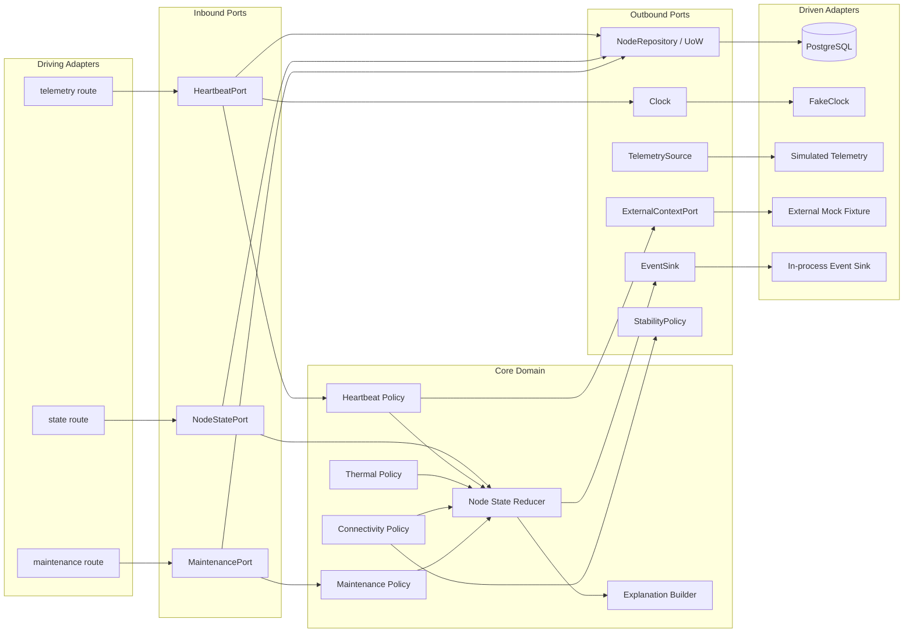

# Module 3 Ports and Adapters

The design is reducer-centric hexagonal architecture. Every component is assigned exactly once below. Paths are intended implementation locations, not production logic created by Solu-2.

| Layer | Component/path | Responsibility |
|---|---|---|
| Driving Adapter | `api/routes/telemetry.py` | Parse heartbeat HTTP requests, map typed errors, call `HeartbeatPort` |
| Driving Adapter | `api/routes/node_state.py` | Parse state-transition preview/evaluation requests; never mutate domain directly |
| Driving Adapter | `api/routes/maintenance.py` | Parse Carlos fixture maintenance request and call `MaintenancePort` |
| Inbound Port | `ports/in/heartbeat.py::HeartbeatPort` | `ingest_heartbeat(node_id, payload, at)` |
| Inbound Port | `ports/in/node_state.py::NodeStatePort` | `transition_node_state(node_id, signal)` and side-effect-free preview |
| Inbound Port | `ports/in/maintenance.py::MaintenancePort` | `schedule_maintenance_drain(node_id, window)` |
| Core Domain | `domain/node_state.py` | Closed enums, aggregate facts, fixed-precedence reducer, transition guards |
| Core Domain | `domain/heartbeat_policy.py` | Strict silence, ordering disposition, boot succession rules |
| Core Domain | `domain/thermal_policy.py` | Strict `>88°C` activation and explanation facts |
| Core Domain | `domain/connectivity_policy.py` | Evidence-only hold or configured StabilityPolicy classification |
| Core Domain | `domain/maintenance_policy.py` | Immediate cordon; fresh-post-lock-zero completion; no workload control |
| Core Domain | `domain/explanation.py` | Structured explanation/evaluation trace value objects |
| Outbound Port | `ports/out/node_repository.py::NodeRepository` | Atomic revision-conditional aggregate/UoW persistence |
| Outbound Port | `ports/out/clock.py::Clock` | Return explicit UTC instant to application layer; no domain wall-clock access |
| Outbound Port | `ports/out/telemetry_source.py::TelemetrySource` | Supply simulated heartbeats/connectivity evidence |
| Outbound Port | `ports/out/external_context.py::ExternalContextPort` | Read immutable `EXTERNAL_MOCK` workload/reservation snapshots |
| Outbound Port | `ports/out/event_sink.py::EventSink` | Atomically stage domain/audit events for commit |
| Outbound Port | `ports/out/stability_policy.py::StabilityPolicy` | Versioned ODD-5 classification contract; absent policy returns unresolved |
| Driven Adapter | `adapters/db/postgres_node_repository.py` | PostgreSQL implementation using conditional updates/transactions |
| Driven Adapter | `adapters/sim/fake_clock.py` | Deterministic manually advanced clock |
| Driven Adapter | `adapters/sim/simulated_telemetry.py` | Canonical 32-node/33-GPU fixtures and mandatory fault sequences |
| Driven Adapter | `adapters/sim/external_context_fixture.py` | Read-only mocked workload/reservation snapshots |
| Driven Adapter | `adapters/events/in_process_event_sink.py` | Test/prototype event capture; no external observability platform |

## Port contracts and purity

- `domain/` imports no FastAPI, Pydantic transport model, ORM/database driver, DB session, network client, DCGM, Prometheus, Kubernetes, CUDA/NVML, or framework context.
- `domain/` calls neither `datetime.now()` nor `random`; reducers receive immutable facts and explicit evaluation instants.
- `Clock` is an outbound port used by application services. The resulting instant enters domain value objects; the domain does not call the adapter.
- Telemetry, GPU, system clock, workload, and reservation inputs are simulated driven adapters. There is no physical hardware fallback.
- DTOs and port signatures contain primitive/domain-safe values only. FastAPI `Request`, database sessions, Kubernetes/DCGM objects, ORM entities, and transport clients are forbidden.
- `NodeRepository.commit(expected_revision, mutation)` is one atomic transaction spanning node projection, lock, telemetry/evidence, history, alert/diagnostic, audit, idempotency result, and staged events. It returns the committed projection or a revision conflict.
- No port offers reserve, place, schedule, evict, checkpoint, terminate, inference, model-catalog, or enterprise-observability behavior.
- Accepted ingress cannot be silently dropped. Numeric buffer/queue capacity is deferred under NFR-12; adapters make no production-throughput claim.

## Component diagram

Dependency direction is inward: adapters depend on ports; the domain depends only on domain-safe abstractions. PostgreSQL and simulation adapters are replaceable and never imported by the domain.
